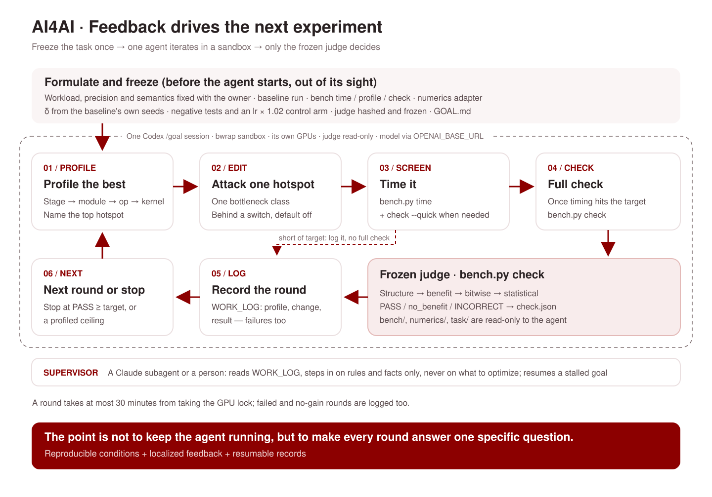

<p align="center">
  
</p>

<p align="center">
  <a href="README.md">English</a> | <a href="README.zh-CN.md">简体中文</a>
</p>

<p align="center">让 AI 加速推动 AI 进步的研究。</p>

ResearchBoost-Agent 致力于将 AI 的能力转化为更快的科研迭代，从研究者每天运行的训练代码开始。它自主分析瓶颈、实施优化，并通过冻结的评测协议验证加速收益，让同样的算力预算承载更多探索。

## 快速开始

给 agent 配好模型端点：

```bash
cp goal/codex.env.example goal/codex.env
# 编辑 goal/codex.env：填 OPENAI_API_KEY 和 OPENAI_BASE_URL（可选 CODEX_MODEL）
```

然后让你的 agent 按 [docs/run-a-task.md](docs/run-a-task.md) 操作。

## 一次运行怎么进行



1. **出题。** 所有者先定下不能变的东西：上游工作负载和每卡负载、参考精度、训练语义。出题的 agent 为这个任务搭判卷（`bench/` 加一份冻结的 [`numerics/`](numerics)），录参考、冻结 δ，用已知有问题的候选证明每一关都能触发，再写 `GOAL.md`。
2. **goal 模式运行。** 一个 Codex `/goal` 会话在 bubblewrap 沙箱里拿到工作区、GPU 和 skill 卡。每一轮先对当前最好的版本 profile，挂开关改一个热点，用 `bench.py time` 测，在 `WORK_LOG.md` 记一轮。监督者在外面看护，只在规则和事实层面介入，不给优化方向。见 [docs/goal-mode.md](docs/goal-mode.md)。
3. **只认判卷。** `bench.py check` 是唯一判据。完整 check 判 PASS 之后，再用真实的端到端训练或评测确认。

## 已有结果

| 任务 | 上游 | 优化时的硬件 | 判卷结论 | 加速 | 代码 |
|---|---|---|---|---|---|
| RAE Stage-1 训练（解码器 + GAN） | bytetriper/RAE @a4d18c4 | 2 × H200 | PASS，统计等价 | **5.32×**；8 × H20 完整训练 16 epoch：rFID 0.541，公开权重 0.569 | [Faster-RAE](https://github.com/AI4AI-for-Anything/Faster-RAE) |
| Self-Forcing 视频 DMD 训练 | guandeh17/Self-Forcing @33593df | 2 × H200 | PASS，统计等价 | **2.08×** | [Faster-SelfForcing](https://github.com/AI4AI-for-Anything/Faster-SelfForcing) |
| LLaVA-1.5-7B 第二阶段微调 | haotian-liu/LLaVA @c121f04 | 4 × H20 | PASS，统计等价 | **2.39×**；真实训练 1 epoch，四个评测与官方权重相差 −0.50 ~ +0.44 | [Faster-LLaVA](https://github.com/AI4AI-for-Anything/Faster-LLaVA) |
| DMD2 一步蒸馏（SD1.5 + GAN） | tianweiy/DMD2 @8d8fa55 | 4 × H20 | PASS，统计等价 | **1.72×**；8 × H20 上 FID-30k 8.70，参考 8.65 | [Faster-DMD](https://github.com/AI4AI-for-Anything/Faster-DMD) |

## 判卷

候选只有过了任务的冻结判卷才算数。判卷按顺序逐关判，前一关不过就停：

0. **结构**：判卷要驱动的训练入口没被改动（AST 比对），数据加载逐位相同，精确项全部一致（阶段、调用次数、随机数指纹、学习率、跨卡同步）。
1. **收益**：参考 → 候选 → 参考，在独立进程里各计时一次；加速不超过 `max(1.02, 1 + 2 × 两次参考相对差)` 就判 no_benefit，不评精度。
2. **逐位**：短程确定性用例记录的全部张量与参考逐位相同，直接通过。
3. **统计**：做不到逐位时，跑配对 seed 的训练轨迹，每个终点都必须在 δ 内。δ 取参考自身换 seed 的 2 倍标准差，在看到任何候选之前冻结。

判卷在优化开始前冻结并记哈希，**绝不为了放过某个候选而放宽**，细节见 [docs/judge.md](docs/judge.md)。

## 出一个新任务

先读 [AGENTS.md](AGENTS.md) 和 [docs/methodology.md](docs/methodology.md)，把 [`goal/templates/FORMULATOR_BRIEF.md`](goal/templates/FORMULATOR_BRIEF.md) 交给出题的 agent，以 [`tasks/dmd2`](tasks/dmd2) 为模板：`GOAL.md`、带 `check` / `time` / `profile` 的 `bench/`、给 [`numerics/`](numerics) 写的任务适配器，以及重建环境、冻结参考的 prep 脚本。

## 目录

| 路径 | 内容 |
|---|---|
| [`docs/`](docs) | 英文文档：[方法](docs/methodology.md)、[判卷](docs/judge.md)、[goal 模式](docs/goal-mode.md)、[运行一个任务](docs/run-a-task.md)、[四个任务的经验](docs/lessons.md) |
| [`goal/`](goal) | 运行一个 Codex `/goal` 会话：bubblewrap 沙箱、Codex 配置模板和模型访问文件、启动 / 续跑 / 看门狗脚本、给出题和监督 agent 的说明 |
| [`numerics/`](numerics) | 各任务判卷复制后冻结的等价判定组件：记录、逐位和分档比对、配对 seed 轨迹、任务适配器基类、自测 |
| [`skills/`](skills) | 8 张 skill 卡，选点前读：`train-opt-*`（分级 profile、计时、动作阶梯、数值验证、融合模式、FSDP 多次前向）和 `sglang-diffusion-*`（扩散模型的 benchmark 与性能手段） |
| [`tasks/`](tasks) | 每个任务：agent 当时看到的 `GOAL.md`、冻结的判卷代码、存档的判卷记录、监督记录和 prep 脚本 |

## 致谢

感谢 [SGLang](https://github.com/sgl-project/sglang) 项目。本项目一部分 kernel 优化相关的 skill 移植自 SGLang：[`skills/sglang-diffusion-benchmark-profile`](skills/sglang-diffusion-benchmark-profile) 和 [`skills/sglang-diffusion-performance`](skills/sglang-diffusion-performance) 改编自 [`python/sglang/multimodal_gen/.agents/skills`](https://github.com/sgl-project/sglang/tree/main/python/sglang/multimodal_gen/.agents/skills) 中的 skill，原项目采用 Apache-2.0 许可证。
